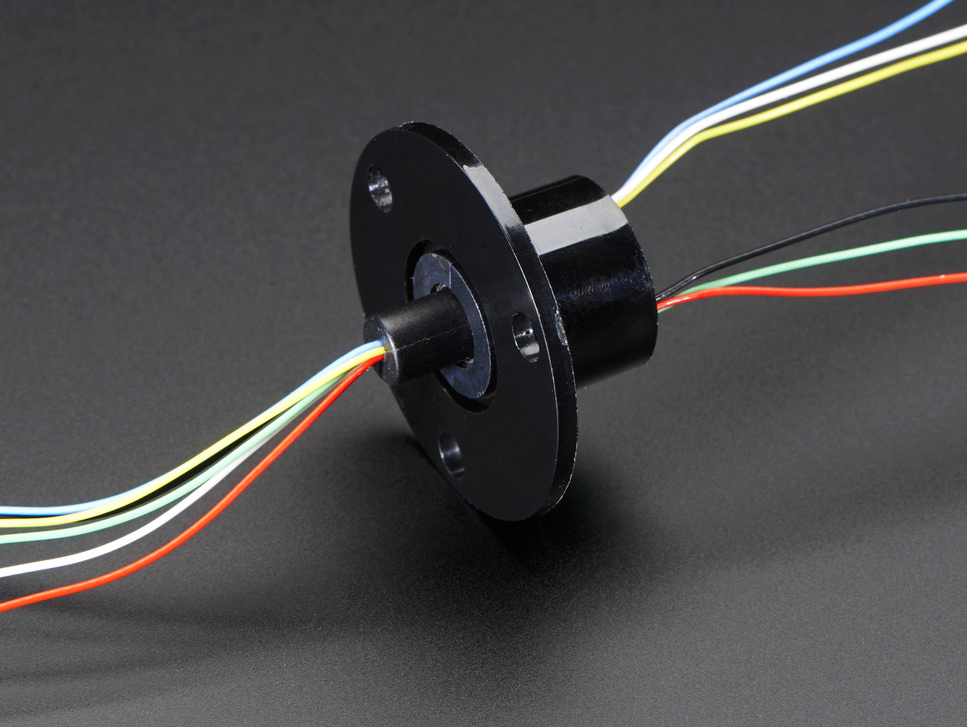
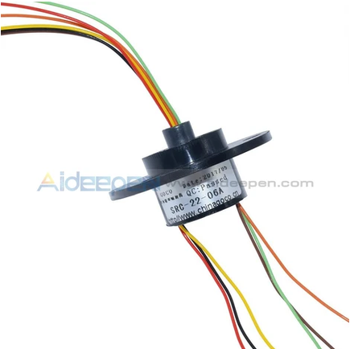
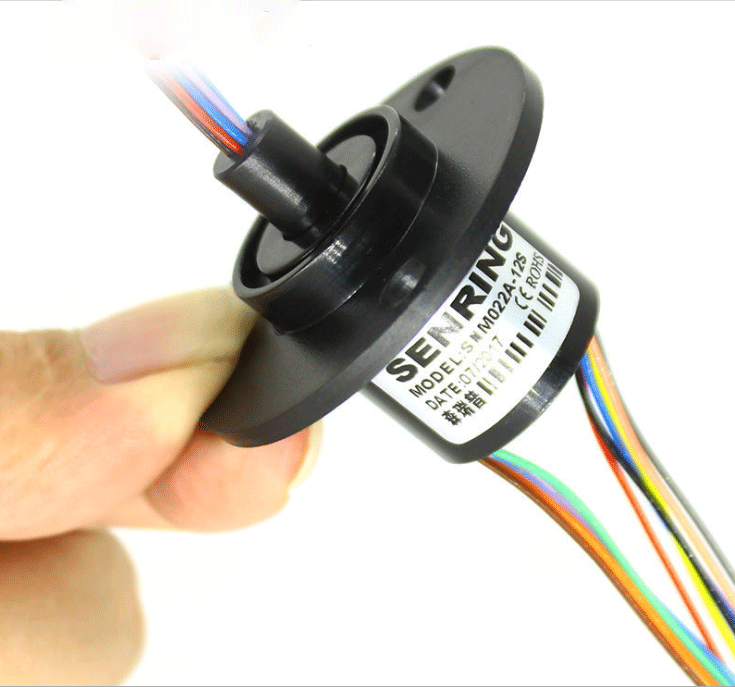

**My Top 3 Options for Slip Rings**

| **Solution**                                                                                                                                                                                      | **Pros**                                                                                                                                    | **Cons**                                                                                            |
| ------------------------------------------------------------------------------------------------------------------------------------------------------------------------------------------------- | ------------------------------------------------------------------------------------------------------------------------------------------- | --------------------------------------------------------------------------------------------------- |
|  **Option 1.** \* Slip Ring with Flange - 22mm diameter, 6 wires, max 240V @ 2A $14.95/each \*[link to product](https://www.adafruit.com/product/736?utm_source=chatgpt.com)                 | \* Lower no-load current reduces battery demand; smallest stall-current requirement; integrated encoder supports closed-loop position control; compact and lightweight. \*Mounting flange with holes makes it easier to attach to a stationary bracket. \*Supports up to 300 RPM, comfortably above your motor's 108 RPM no-load speed. \*Six independent channels provide two extras beyond the sensor's four connections. \*Adafruit provides a manufacturer datasheet and dimensional information. \*Gold-plated contacts and 2A current rating per channel.                                                | \* Lowest available torque; slower scanning; may struggle if the sensor mounting assembly is heavy or has substantial friction.  |
|  **Option 2.** \* 22mm 6 Wires 6 Conductors Capsule Compact Slip Ring 220V AC 250Rpm CCTV Monitor  \* $7.99/each  \* [Link to product](https://www.aideepen.com/products/22mm-6-wires-6-conductors-capsule-compact-slip-ring-220v-ac-250rpm-cctv-monitor?utm_source=chatgpt.com) | \* Better torque and speed than LP; integrated encoder; moderate current requirement; same compact dimensions; good candidate for balancing performance and power.   | * Higher current than LP; requires closed-loop position control; may still need gearing or speed reduction for smooth scanning speed.                                                         |
|  **Option 3.** \* 12.5mm 300rpm 6 Wires CIRCUITS 2A Capsule Slip Ring AC 240V Motor Robotics  \* $13.42/each  \* [Link to product](https://www.ebay.com/itm/303070939018?utm_source=chatgpt.com) | \* Highest available torque; fastest motion; integrated encoder; better suited to mechanically demanding loads  | *Highest current consumption; more demanding driver and power-supply requirements; faster motion may require more careful acceleration and braking control.                                                         |

**Choice:** Option 2: Pololu 100:1 Micro Metal Gearmotor MP 6V with 12 CPR Encoder (Part #5138)

**Rationale:** The Pololu 100:1 Medium-Power Micro Metal Gearmotor is the preliminary selection for the scanning subsystem because it provides a balance between rotational speed, available torque, electrical current requirements, and physical size. Its 100.37:1 gearbox provides mechanical reduction, while its integrated quadrature encoder allows the PIC18F57Q43 microcontroller to monitor motor rotation and implement position feedback.

Compared to the low-power alternative, the medium-power motor offers increased torque and speed, which may improve its ability to move the LiDAR scanning assembly. Compared to the high-power alternative, it has a lower stall current, reducing the electrical demands on the motor driver and power system.

The motor is also compact and lightweight, making it a promising candidate for a handheld device. Final selection will depend on testing the scanning assembly's torque requirements, scan speed, encoder performance, and compatibility with the regulated motor supply.