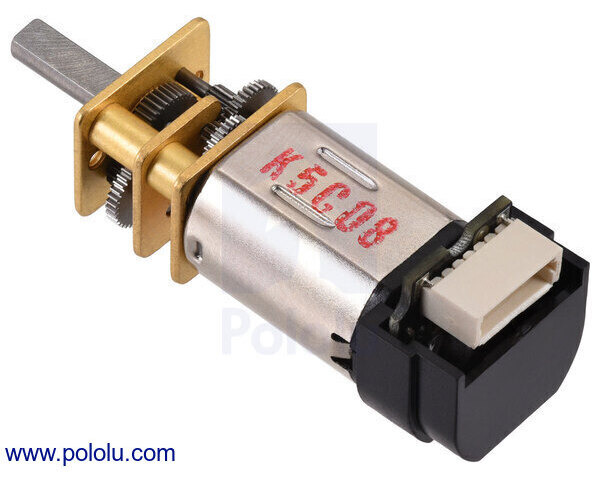

## Examples

### Style 1

> This is the example found in the assignment, uses more html

*Table 1: Example component selection*

**External Clock Module**

| **Solution**                                                                                                                                                                                      | **Pros**                                                                                                                                    | **Cons**                                                                                            |
| ------------------------------------------------------------------------------------------------------------------------------------------------------------------------------------------------- | ------------------------------------------------------------------------------------------------------------------------------------------- | --------------------------------------------------------------------------------------------------- |
|  Option 1.  XC1259TR-ND surface mount crystal $1/each [link to product](http://www.digikey.com/product-detail/en/ECS-40.3-S-5PX-TR/XC1259TR-ND/827366)                 | \* Inexpensive[^1] \* Compatible with PSoC \* Meets surface mount constraint of project                                               | \* Requires external components and support circuitry for interface \* Needs special PCB layout. |
|  \* Option 2.  \* CTX936TR-ND surface mount oscillator  \* $1/each  \* [Link to product](http://www.digikey.com/product-detail/en/636L3I001M84320/CTX936TR-ND/2292940) | \* Outputs a square wave  \* Stable over operating temperature   \* Direct interface with PSoC (no external circuitry required) range | * More expensive  \* Slow shipping speed                                                         |
s
**Choice:** Option 2: CTX936TR-ND surface mount oscillator

**Rationale:** The Pololu 100:1 Medium-Power Micro Metal Gearmotor is the preliminary selection for the scanning subsystem because it provides a balance between rotational speed, available torque, electrical current requirements, and physical size. Its 100.37:1 gearbox provides mechanical reduction, while its integrated quadrature encoder allows the PIC18F57Q43 microcontroller to monitor motor rotation and implement position feedback.

Compared to the low-power alternative, the medium-power motor offers increased torque and speed, which may improve its ability to move the LiDAR scanning assembly. Compared to the high-power alternative, it has a lower stall current, reducing the electrical demands on the motor driver and power system.

The motor is also compact and lightweight, making it a promising candidate for a handheld device. Final selection will depend on testing the scanning assembly's torque requirements, scan speed, encoder performance, and compatibility with the regulated motor supply.