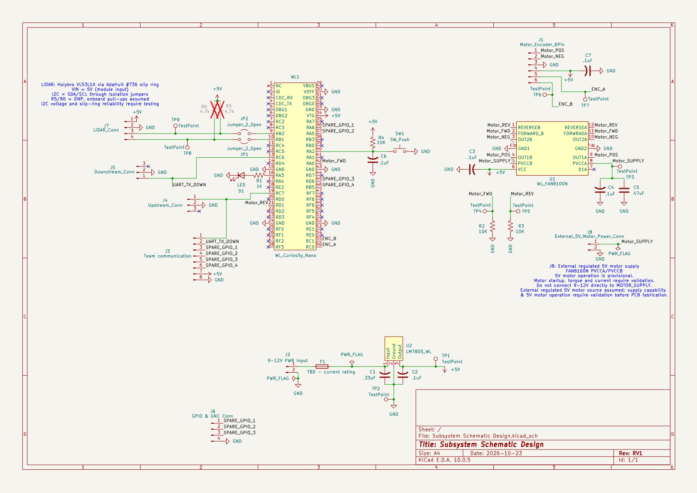

## Overview

## Overview

This schematic is designed to support the motor control and LiDAR scanning subsystem of our team's 360-degree obstacle detection system. The design utilizes a **PIC18F57Q43 Curiosity Nano** microcontroller and a **FAN8100N H-bridge** to control a DC gear motor, while its integrated quadrature encoder provides feedback for monitoring rotational speed and angular position.

The subsystem also incorporates a **Holybro VL53L1X Time-of-Flight sensor**, which communicates with the microcontroller through I2C. An **Adafruit 6-wire slip ring** is planned to allow the sensor to rotate continuously without twisting its electrical connections.

Additional circuitry includes voltage regulation, power filtering capacitors, debugging components, and UART connections for communication with other team subsystems. Together, these components provide the electrical design needed to support continuous LiDAR scanning and obstacle detection.

The schematic represents the proposed subsystem design, with final power requirements and communication reliability to be verified during hardware testing.

{style width:"350" height:"300;"}
**Figure 1:** Showing a example schematic.

## Resouces

The schematic as a PDF download is available [*here*](Subsystem_Schematic_Design.pdf), and the Zip folder of the project [*here*](Subsystem_Schematic_Design.zip).