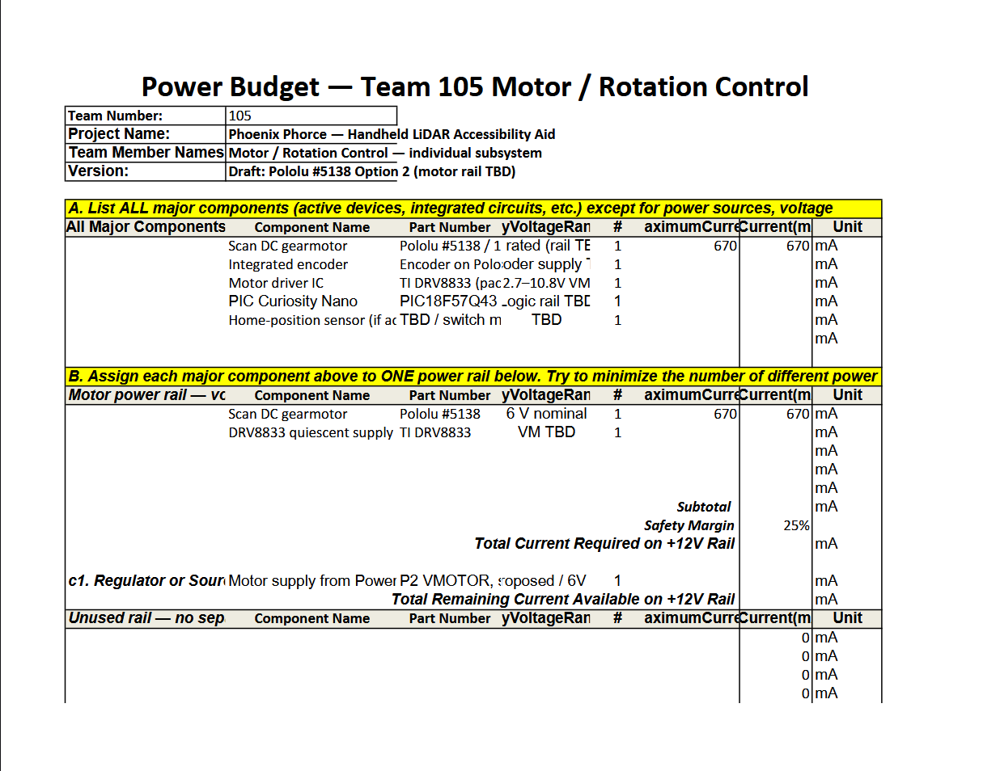
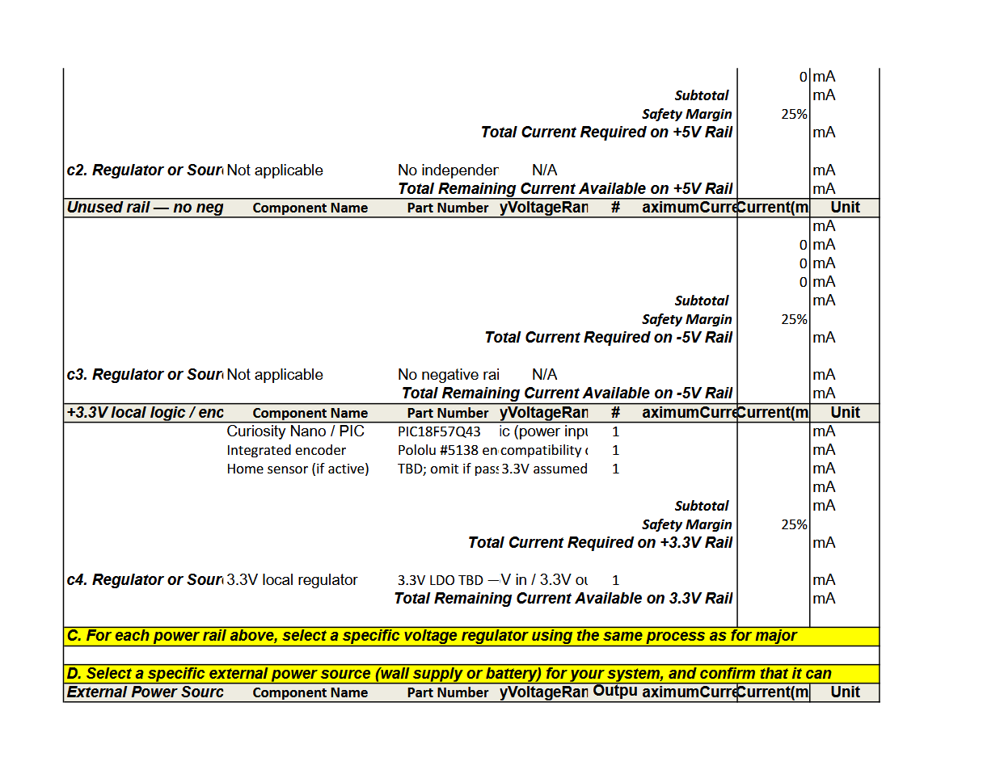
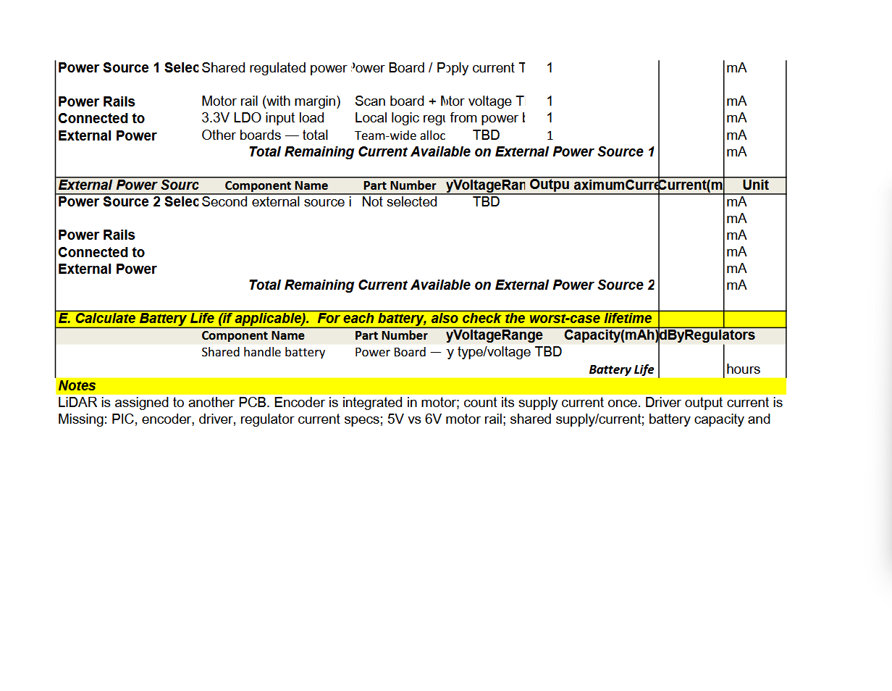

## Overview
The purpose of this power budget is to determine the electrical requirements of the Motor and Rotation Control subsystem for Team 105's Handheld LiDAR Accessibility Aid.

The subsystem uses a PIC18F57Q43 Curiosity Nano microcontroller, a Pololu 100:1 Medium-Power Micro Metal Gearmotor (Part #5138) with an integrated quadrature encoder, and a DRV8833 motor driver.

The power budget identifies the voltage and current requirements of these components, considers the necessary voltage regulation, and evaluates the power needed to operate the scanning mechanism.

A 25% safety margin is included when determining the required current capacity of the power supply.
mkmklms
## Power Budget Tables

The following images show the preliminary power budget for the Motor and Rotation Control subsystem.

> Capture your power budge as a image to display. Take time to get clean breaks and a well organized layout.

## Conclusions

The power budget identifies the electrical requirements of the selected scanning motor, integrated encoder, motor driver, and microcontroller.

The selected Pololu #5138 motor has a nominal operating voltage of 6 V and a stall current of 670 mA at its rated voltage. The motor's supply voltage must be coordinated with the team's Power Board to ensure compatibility with the final design.

The power budget will be updated as the remaining electrical specifications, regulator selections, and battery requirements are finalized.

## Resouces

The completed power budget is available in the following formats:

- [Download Power Budget (PDF)](PowerBudget.pdf)
- [Download Power Budget (Excel)](PowerBudget.xlsx)